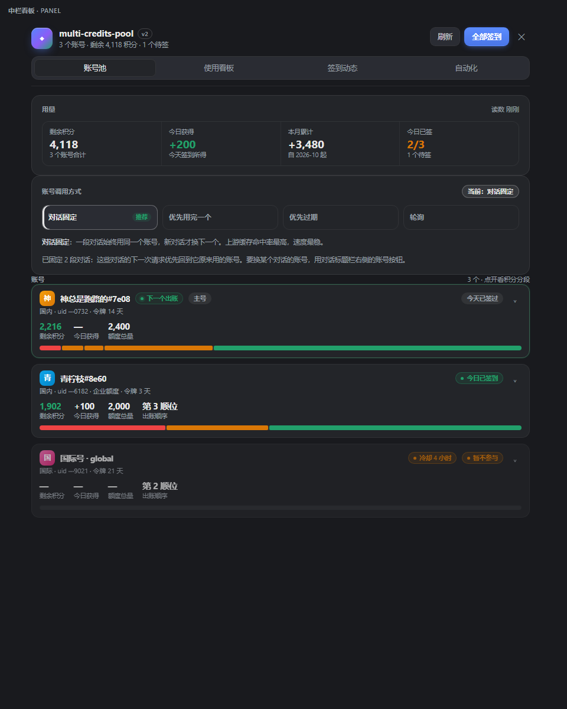
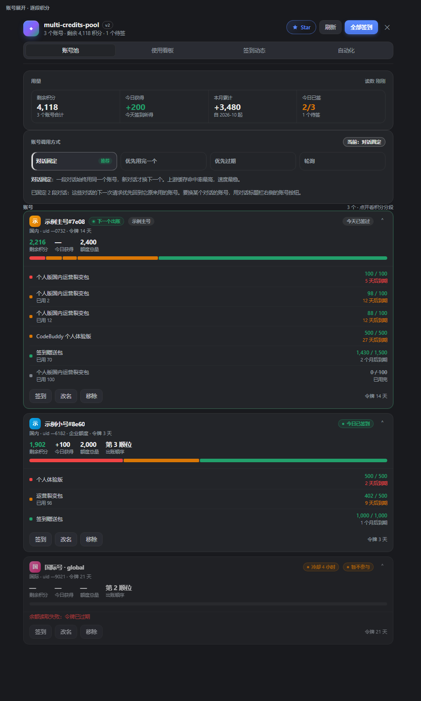
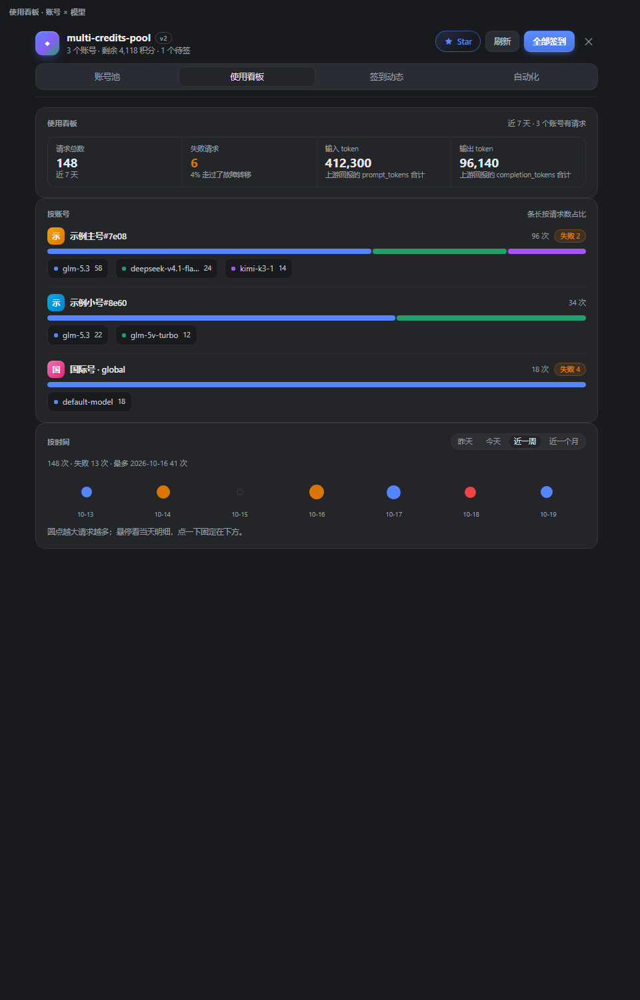
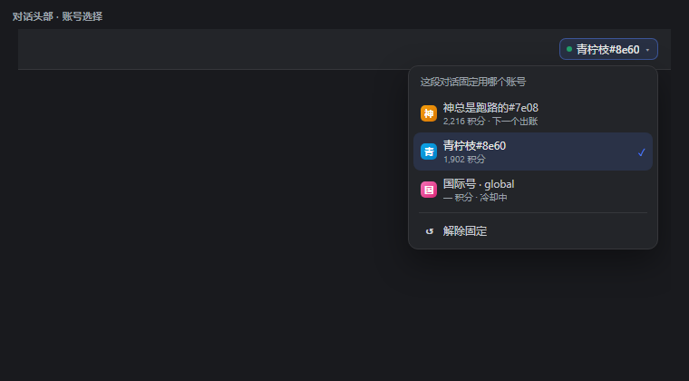
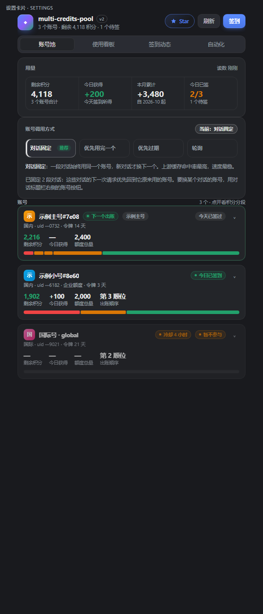
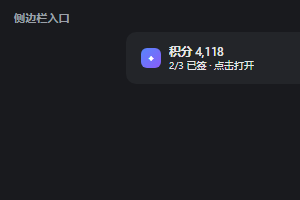

# multi-credits-pool

多账号 WorkBuddy 工具：管理多个账号的登录凭据、每天自动签到、把各账号的积分与套餐汇总到一张表，并把这些账号的模型额度轮换起来接进 DSH 的模型选择器。

纯 ESM JavaScript，零依赖，零构建，要求 Node.js 22.19 及以上（或使用 DSH 桌面版自带运行时）。

```powershell
npm install -g multi-credits-pool   # 只是为了跑命令行
```

作为 DSH 插件安装时，在插件的安装入口填包名 `multi-credits-pool` 即可。

## 界面

| 中栏看板 | 账号展开 · 逐段积分 |
| --- | --- |
|  |  |

| 使用看板 · 账号 × 模型 | 对话头部 · 账号选择 |
| --- | --- |
|  |  |

| 设置卡片 | 侧边栏入口 |
| --- | --- |
|  |  |

截图由 `node tools/preview.mjs --shot` 生成，账号名与数字都是渲染夹具里的假数据。

## 文档

| 文档 | 内容 |
| --- | --- |
| [使用说明](docs/使用说明.md) | 环境准备、账号管理、签到、计划任务、汇总、在 DSH 里使用、命令一览、常见问题 |
| [实现文档](docs/实现文档.md) | 模块划分、数据模型、上游协议、签到流程、调度、宿主插件与模型轮换、渲染与错误处理 |
| [TESTING.md](TESTING.md) | 自测覆盖范围与未覆盖项 |

## 快速开始

```powershell
$env:DSH_PROFILE = 'desktop'
$env:ELECTRON_RUN_AS_NODE = '1'
$repo = "$PWD"                                        # 本仓库克隆下来的目录
$exe = 'D:\DeepSeek Harness\DeepSeek Harness.exe'      # 改成自己的安装位置

& $exe --expose-internals "$repo\bin\credits.js" login --label 主号   # 浏览器授权，追加一个账号
& $exe --expose-internals "$repo\bin\credits.js" checkin             # 所有账号签一遍
& $exe --expose-internals "$repo\bin\credits.js" status              # 今日签到 + 剩余积分
& $exe --expose-internals "$repo\bin\credits.js" schedule-install --at 10:00   # 注册每日计划任务
& $exe --expose-internals "$repo\tools\install-plugin.mjs"           # 装进 DSH profile，模型选择器里出现「multi-credits-pool」
```

机器上已有 Node.js 22.19+ 的话，把 `& $exe --expose-internals` 换成 `node` 即可。

装插件前先完全退出 DSH（托盘也要退），装完再启动；开发态加 `--link` 装成目录联接，改代码只需重启。定位不到数据目录时看 profile 下的 `.multi-credits-pool\boot.log`。

`DSH_HOME` 默认 `~/.dsh`，`DSH_PROFILE` 默认 `default`；桌面版使用 `desktop`。

## 能力

- **多账号**：账号存成数组，可反复 `login` 追加；`import` 接受任何含 `accessToken` 的 JSON 凭据。
- **每日签到**：按账号逐个签，单账号失败不影响其它账号；今天已签过的自动跳过。
- **积分汇总**：`status` 看今日签到与各账号剩余积分，`report` 落盘成 Markdown。
- **两种触发**：`daemon` 常驻进程；`schedule-install` 注册系统计划任务，DSH 没启动也能执行。
- **模型轮换**：装进 DSH profile 后作为一个 provider 出现，多个账号的额度按所选方式自动选用，单个账号额度耗尽或登录态失效时无感换下一个。
- **模型清单跟着上游走**：模型列表不再手写——启动 15 秒后从上游取一次，之后每 24 小时一次，缓存在 `plugin.json`。上游新上线的模型下一次刷新就出现在选择器里，下线的自动消失。
- **只显示要用的模型**：看板「自动化 → 模型选择」里勾选哪些模型出现在 DSH 的模型选择器里，改完立刻生效；卡片头部显示清单上次更新时刻，旁边可手动刷新。至少留一个。
- **半路没额度也不至于停**：换账号只发生在响应开始之前；流已经开始之后才断的，由宿主按 provider 的重试策略重发，重发时欠费账号已进 6 小时冷却，于是落到下一个账号。上下文由宿主带着原样重发，不丢。
- **升级有提示**：看板顶栏的「检查更新」问一次 npm 注册表（结果缓存 10 分钟），查到新版本就变成「可升级 vX.Y.Z」并在标签栏下给出一条命令，复制到终端执行 `multi-credits-pool update` 即可；面板不替自己换代码，运行中的文件被宿主拿着。
- **四种账号调用方式**：在看板上切换，改完立刻生效、不用重启。每个按钮悬停即显示该模式的完整说明，不必先选中再看解释。
  - 对话固定（缺省）：一段对话始终用同一个账号，新对话才换下一个。上游缓存按账号隔离，同一对话反复换账号等于每次从零开始，所以这条最省时也最快。
  - 优先用完一个：先把这个账号的积分用到底，再换下一个。
  - 优先过期：剩余积分里最先过期的先用，减少作废。要看得到每个账号的到期时间才排得准。
  - 轮询：每次请求换下一个账号，消耗摊平，代价是上下文缓存吃不到、速度慢一些。
- **指定某段对话的账号**：对话标题栏右侧有个账号按钮，显示这段对话当前会走哪个账号；点开可以固定到指定账号，或解除固定回到自动分配。非「对话固定」模式下按钮只读，并说明要先切回该模式。
- **使用看板**：按账号 × 模型统计最近的请求——每个账号跑了哪些模型、各多少次、失败多少，另有按天的请求数。用来回答「额度到底被谁烧在哪了」。只统计走本插件的请求，对话用别家 provider 时不会出现在这里。
- **设置面板**：账号看板有三处入口——设置页「插件设置」里的卡片、左侧栏底部的积分入口（点一下打开中栏看板、再点收回）、以及那块中栏看板本身。看板分账号池、使用看板、签到动态、自动化四个页签，可切换调用方式、签到、添加账号、移除账号、改自动签到时刻。
- **跟宿主主题一致的样式层**：面板自带一张随插件下发的样式表，颜色与圆角取自宿主的设计变量，切换深浅色主题不用改设置；悬停、展开、淡入都有过渡，系统开了「减少动态效果」时自动压掉动画。
- **逐段积分明细**：一个账号常挂着好几段积分（同名裂变包买了多份、各在不同的日子到期，另外还叠着体验包、拉新包）。账号卡收起时把每段画成一条分段额度条，宽度是剩余量、颜色是到期紧迫度；点整卡展开逐段表格，每段一行——套餐名、剩余 / 总量、到期时间、距作废还有几天，用到头的段沉底标注。同名套餐不合并，否则看不出哪一份明天就作废。
- **凭据不回显**：`list --json` 只报「有没有令牌」，不输出令牌内容。
- **改名后旧数据自动接上**：包名、数据目录、provider id、显示名、计划任务名统一到 `multi-credits-pool`。旧数据目录 `.dsh-workbuddy-multi` 首次启动自动搬过来，模型页里残留的旧 provider 条目会被清掉，`schedule-install` 重新注册时顺带删掉旧名计划任务。

## 边界

- 走 WorkBuddy 的私有接口（`/v2/billing/meter/daily-checkin`、`/v2/plugin/auth/*`、`/v2/billing/meter/get-user-resource`），上游改协议即失效。
- 只操作账号本人名下的额度；设备标识按 uid 派生，每个账号在上游看来是一台独立设备。账号被限制或额度被清空的风险由使用者承担。
- 签到按 UTC+8 的自然日判定。

## 自测

```powershell
powershell -NoProfile -ExecutionPolicy Bypass -File tools\smoke.ps1
```

在临时数据目录（`.credits-test/`）中执行全部命令，不触碰真实账号库：`tools/smoke.ps1`（CLI，31 项）、`tools/plugin-test.mjs`（假宿主跑 `apply()`，45 项，不联网）、`tools/paths-test.mjs`（数据目录定位与旧目录迁移，16 项）、`tools/model-catalog-test.mjs`（上游清单解析与写回，31 项）、`tools/web-api-test.mjs`（Web 接口，37 项）、`tools/client-test.mjs`（浏览器半边注册契约，37 项）、`tools/ui-test.mjs`（界面渲染断言，136 项）、`tools/rotation-test.mjs`（故障转移、冷却与使用流水，26 项）、`tools/strategy-test.mjs`（四种账号调用方式，31 项）、`tools/pin-usage-test.mjs`（手动固定与用量聚合，45 项）、`tools/effort-fallback-test.mjs`（推理档位降级，9 项）、`tools/chat-request-test.mjs`（请求体整形，81 项）、`tools/update-check-test.mjs`（检查更新与安装参数，41 项，不联网）。真实链路验收用 `tools/proxy-live-test.mjs`（真账号带工具经代理发一条请求，9 项）与 `tools/catalog-live-probe.mjs`（真账号抓一次上游模型清单）。

调界面时用 `node tools\preview.mjs --shot` 生成八个预览页并截成 PNG，落在 `tools/`，不装插件也能看排版；README 里引用的那组在 `docs/screenshots/`。

单独跑某一组就是 `node tools/strategy-test.mjs`，失败时退出码非零。`tools/` 是本地开发目录，不随发布副本走。

## 安装与卸载

### 从模型/插件市场装（推荐）

在 DSH 的插件安装入口填包名 `multi-credits-pool`，或带版本号 `multi-credits-pool@0.3.8`，由宿主的安装器自己下载并挂进 profile。

### 从源码装

```powershell
# 装机：把包拷进 DSH profile 的 node_modules，并在 profile 的 package.json 里挂上
& $exe --expose-internals "$repo\tools\install-plugin.mjs"

# 卸载：删掉依赖与 bundles 条目，插件目录本身保留
& $exe --expose-internals "$repo\tools\install-plugin.mjs" --remove
```

装之前先完全退出 DSH（含托盘），装完再启动。装好之后模型选择器里出现 `multi-credits-pool`，选择它即可；账号看板在设置页「插件设置」、左侧栏底部、以及中栏看板三处都能打开。`--link` 装成目录联接，改代码只需重启宿主。

## 数据与隐私

- 账号凭据、签到记录、用量流水都存在本机数据目录（缺省 `~/.dsh/profiles/<profile>/.multi-credits-pool/`），可用 `DSH_MULTI_CREDITS_POOL_DATA_DIR` 改到别处。令牌是明文 JSON，不要把该目录提交进任何仓库。
- 插件不向外发送任何统计，只与 WorkBuddy 上游通信；Web 接口只监听回环地址，带来源校验。
- `list --json` 等输出只报「有没有令牌」，不回显令牌内容。

## 免责

WorkBuddy 的私有接口随时可能变更，上游一变本插件就失效；多账号轮换、自动签到这类用法是否合规由使用者自行判断并承担后果。作者不对账号受限、额度清空、数据丢失负责。

## 许可

[MIT](LICENSE)
